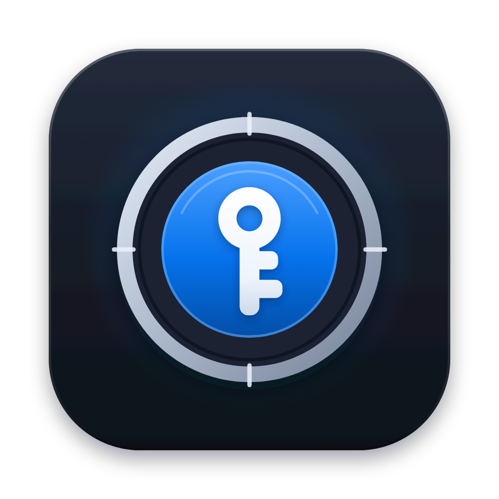

<div align="center">
  
  <h1>Keysmith</h1>
  <p>
    <strong>Local-First · Zero-Knowledge · Cross-Platform Password &amp; Passkey Manager</strong>
  </p>
  <p>
    Powered by <strong>Vaultwarden</strong> encrypted sync and built with <strong>Rust + Tauri v2 + React 19</strong>, complete with a CLI, OpenSSH Agent, and Manifest V3 Browser Extension.
  </p>

  <p>
    <a href="https://github.com/chrisyer/Keysmith/actions/workflows/ci.yml">
      
    </a>
    <a href="https://github.com/chrisyer/Keysmith/actions/workflows/release.yml">
      
    </a>
    <a href="https://github.com/chrisyer/Keysmith/releases">
      
    </a>
    <a href="https://github.com/chrisyer/Keysmith/releases">
      
    </a>
    
    
    
    <a href="./LICENSE">
      
    </a>
  </p>

  <p>
    <a href="https://chrisyer.github.io/Keysmith/">Website</a> •
    <a href="#features">Features</a> •
    <a href="#installation">Installation</a> •
    <a href="#browser-extension">Browser Extension</a> •
    <a href="#cli--ssh-agent">CLI &amp; SSH Agent</a> •
    <a href="#building-from-source">Build from Source</a> •
    <a href="#project-structure">Architecture</a> •
    <a href="#license">License</a>
  </p>
</div>

---

_Keysmith is an independent, local-first desktop client, CLI, and browser extension compatible with [Vaultwarden](https://github.com/dani-garcia/vaultwarden) / Bitwarden servers._

## Features

- **Zero-Knowledge Security Core (`crates/keysmith-core`)**:
  - Full Vaultwarden / Bitwarden protocol compatibility (`Argon2id` / `PBKDF2-SHA256` + `HKDF` + `AES-256-CBC-HMAC` `EncString Type 2` authenticate-then-decrypt).
  - Minimal in-memory secret exposure (`zeroize`), zero plaintext cached in SQLite, automatic `401` token refresh, and offloaded crypto via `spawn_blocking`.
  - **OS-Level Security Integration**: Auto-lock on sleep/lid-close/screen-lock, concealed/transient `NSPasteboard` clipboard protection with auto-clear countdown on macOS, screen-capture protection toggle, Touch ID / biometric unlock with configurable master-password reprompt intervals.
- **Native Desktop App (`apps/desktop`)**:
  - Translucent sidebar vibrancy, system tray bar persistence, **Quick Access** global overlay (`⌘⇧Space`), and **Large Type** floating window cleared instantly on lock.
  - Real-time **SignalR WebSocket** sync (`/notifications/hub`) and Organization / Collection support.
  - **19 Item Templates** (Login, Password, Secure Note, Credit Card, Identity, API Credential, Database, Server, SSH Key, Software License, Passkey, Bank Account, Crypto Wallet, Wi-Fi Router, Passport, Driver License, Membership, Medical Record, Document), archiving, duplicating, and multi-select batch actions.
  - Built-in **Password / Passphrase / PIN / Username Generator** with encrypted history, **Vaultwarden Send** (encrypted text & file links), one-click **Ed25519 SSH key generation**, **TOTP QR** clipboard/image scanner, encrypted attachments, private favicon cache, Watchtower audit (+ HIBP k-anonymity check), multi-account switching, and `.1pux` / Bitwarden JSON & CSV / Chrome & Safari CSV import/export.
- **Browser Extension (`apps/browser-extension`)**:
  - Chrome / Edge / Arc / Brave Manifest V3 extension supporting inline autofill, TOTP clipboard copy, save/update password banner, **WebAuthn Passkey** capture & assertion (`navigator.credentials.create/get`), item detail drill-down, Chrome default password manager takeover (`chrome.privacy`), and never-prompt site exclusions.
  - Zero-CLI auto-configuration: Keysmith writes Native Messaging host manifests automatically on launch and unpacks the extension to the OS application data directory.
- **Multilingual UI (Default: English)**:
  - Full live-switchable localization across both Desktop (UI + native menus) and Browser Extension: **English (default)**, **简体中文**, **繁體中文**, **日本語**, **한국어**, **Deutsch**, **Français**, and **Español** (+ System Default detection).

---

## Installation

### Windows (Windows 10 / 11 x64)

Download `Keysmith_<version>_x64-setup.exe` (NSIS) or the `.msi` installer from [GitHub Releases](https://github.com/chrisyer/Keysmith/releases) and run the installer.

On launch, Keysmith extracts the browser extension to `%APPDATA%\dev.keysmith.desktop\browser-extension` and automatically registers Native Messaging for Chrome, Edge, Brave, Chromium, and Vivaldi.

### macOS (macOS 13+ Apple Silicon & Intel)

#### Option 1: One-Line Installer (Recommended — bypasses Gatekeeper quarantine cleanly)

```bash
curl -fsSL https://raw.githubusercontent.com/chrisyer/Keysmith/main/install.sh | sh
```

#### Option 2: Homebrew Cask

```bash
brew tap chrisyer/keysmith https://github.com/chrisyer/Keysmith.git
brew install --cask chrisyer/keysmith/keysmith
```

To upgrade later, run `brew upgrade --cask chrisyer/keysmith/keysmith` (the `chrisyer/keysmith/` prefix is required to avoid colliding with Homebrew's unrelated official `keysmith` cask).

#### Option 3: Manual `.dmg` Download

Download the matching architecture (`aarch64` or `x64`) `.dmg` from [GitHub Releases](https://github.com/chrisyer/Keysmith/releases) and drag `Keysmith.app` into `/Applications`. Because builds are ad-hoc signed without paid Apple Developer notarization, if macOS blocks first launch, allow it via **System Settings → Privacy & Security → Open Anyway** or run:

```bash
xattr -cr /Applications/Keysmith.app
```

---

## Browser Extension

Keysmith uses a fixed Extension ID (`ianpdijhflnmmhbmjdhiombdghhpfkmg`) and auto-configures Native Messaging whenever the desktop app starts.

1. Launch **Keysmith** desktop and unlock your vault.
2. Open `chrome://extensions` (or `edge://extensions`, `arc://extensions`, `brave://extensions`) and enable **Developer mode**.
3. Open **Settings → Browser Extension** inside Keysmith and click **Open Extension Folder**, then click **Load unpacked** in Chrome and select that folder.
4. Click the Keysmith toolbar icon to autofill logins, cards, identities, TOTP codes, and Passkeys.

---

## CLI & SSH Agent

```bash
# Inspect status, search vault items, or generate secrets
ks status
ks list
ks generate --length 20

# Start the in-memory OpenSSH Ed25519 signing agent (SSH_AUTH_SOCK)
ks ssh-agent

# Optional manual Native Messaging setup for custom unpacked extension IDs
ks install-nmh --chrome <EXTENSION_ID>
```

---

## Building from Source

```bash
# Run full Rust workspace tests (keysmith-core + keysmith-cli + keysmith-desktop)
cargo test --workspace

# Typecheck and build the desktop frontend
npm --prefix apps/desktop ci
npm --prefix apps/desktop run typecheck && npm --prefix apps/desktop run build

# Build release CLI binaries (target/release/ks & target/release/keysmith-ssh-agent)
cargo build --release -p keysmith-cli

# Bundle desktop application
npx --prefix apps/desktop tauri build --bundles app
```

---

## Project Structure

```text
Keysmith/
├── assets/                             # App & menu bar icons
├── crates/
│   ├── keysmith-core/                  # Zero-knowledge crypto, Vaultwarden REST/SignalR, SQLite, SSH, QR
│   └── keysmith-cli/                   # ks CLI, keysmith-ssh-agent, and Native Messaging Host
└── apps/
    ├── desktop/                        # React 19 + Vite frontend & Tauri v2 native shell
    └── browser-extension/              # Chrome Manifest V3 autofill & WebAuthn Passkey extension
```

---

## License

Keysmith is licensed under the [Mozilla Public License 2.0](./LICENSE) (`MPL-2.0`).
