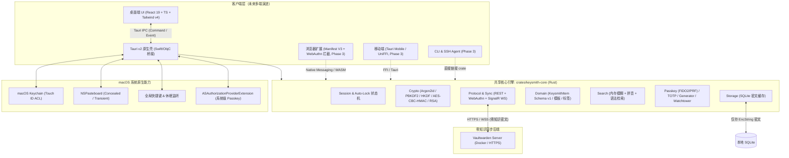
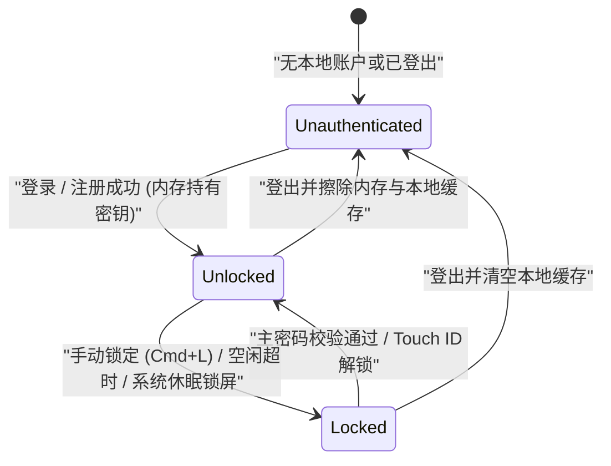

# 01 — 系统架构与安全边界设计

## 1. 总体系统架构

Keysmith 采用 **“厚 Rust 核心 + 轻量多端壳”** 架构：所有密码学原语、Vaultwarden 协议通信、本地加密缓存、搜索索引、TOTP 与安全审计均收口于 `crates/keysmith-core`；桌面端及其他未来客户端仅承担 UI 渲染与系统原生桥接（生物识别、快捷键、剪贴板、系统托盘）。



---

## 2. Monorepo 目录规划

```text
keysmith/
├── Cargo.toml                          # Rust Workspace（管理 keysmith-core 与 src-tauri）
├── package.json                        # pnpm workspace（管理 apps/desktop 等前端工程）
├── docker/
│   ├── docker-compose.yml              # 本地 Vaultwarden 容器编排（含 Caddy 反代/WebSocket）
│   └── .env.example                    # SIGNUPS_VERIFY=false 等本地开发环境变量
├── docs/                               # 本套架构、协议与 UI 设计文档
├── crates/
│   └── keysmith-core/                  # 纯 Rust 核心引擎（无 UI 依赖，可跨端编译）
│       ├── Cargo.toml
│       └── src/
│           ├── lib.rs
│           ├── error.rs                # 统一错误枚举（可序列化为前端可读错误码）
│           ├── traits.rs               # 平台抽象 Trait（BiometricKeyStore, ClipboardManager）
│           ├── crypto/                 # KDF, HKDF, EncString, RSA-OAEP, Zeroizing 封装
│           ├── protocol/               # Vaultwarden HTTP/SignalR 客户端与 DTO
│           ├── domain/                 # KeysmithItem Schema v1, Vault, Template 注册表, 校验
│           ├── storage/                # SQLite Schema 迁移与密文仓储
│           ├── sync/                   # 全量同步、增量推送、冲突处理
│           ├── search/                 # 解锁态内存倒排/模糊/拼音与检索语法解析
│           ├── passkey/                # WebAuthn CTAP/COSE 密钥生成、RP 校验、断言签名
│           ├── totp/                   # RFC 6238 / otpauth:// 解析与动态验证码
│           ├── generator/              # CSPRNG 随机密码、Diceware 助记词、PIN、强度评估
│           ├── watchtower/             # 弱密码/复用/HTTP/2FA 审计引擎
│           └── session/                # 会话状态机、解锁/锁定、自动锁计时器
└── apps/
    ├── desktop/                        # Tauri v2 桌面客户端
    │   ├── package.json
    │   ├── index.html                  # 主窗口入口
    │   ├── quick-access.html           # Quick Access 悬浮搜索窗口入口（Phase 2）
    │   ├── src/                        # React 19 + TypeScript + Tailwind CSS v4
    │   │   ├── components/             # 基础组件、三色密码、Large Type、TOTP 环
    │   │   ├── features/               # Sidebar, ItemList, ItemDetail, Watchtower, Auth
    │   │   ├── stores/                 # Zustand (sessionStore, vaultStore, uiStore)
    │   │   ├── services/               # 强类型 Tauri IPC 封装
    │   │   └── quick-access/           # Quick Access 独立轻量视图
    │   └── src-tauri/                  # Tauri 原生宿主（Rust + macOS Swift/ObjC 桥）
    │       ├── Cargo.toml
    │       ├── tauri.conf.json
    │       └── src/
    │           ├── main.rs
    │           ├── commands/           # Tauri IPC Command 分组导出
    │           ├── events.rs           # 向前端广播状态与同步事件
    │           └── macos/              # Touch ID Keychain, NSPasteboard, Sleep Observer
    ├── extension/                      # [预留 Phase 3] Manifest V3 浏览器插件
    ├── cli/                            # [预留 Phase 3] keysmith (ks) CLI & SSH Agent
    └── mobile/                         # [预留 Phase 3] 移动端客户端
```

---

## 3. `keysmith-core` 模块职责与边界

| 模块 | 核心职责 | 对外边界约束 |
| :--- | :--- | :--- |
| `crypto` | Argon2id / PBKDF2-SHA256 派生、HKDF-Expand、AES-256-CBC + HMAC-SHA256 (`EncString`)、RSA-2048 OAEP、密钥随机生成 | 所有密钥类型强制包装在 `zeroize::Zeroizing<T>`；严禁提供明文密钥的 `Debug`/`Serialize` |
| `protocol` | 对接 Vaultwarden `/identity/*`、`/api/*` 与 `/notifications/hub`（SignalR） | 仅处理加密后的 DTO，不接触明文密码与未加密的 `ItemPayload` |
| `storage` | SQLite 建表与迁移、离线密文读写、Token 安全存取、同步游标管理 | **磁盘零明文原则**：不落盘任何明文条目内容与主密码派生密钥 |
| `domain` | `ItemPayload`、`Vault`、19 种条目模板元数据、字段类型转换与校验 | 不感知 Vaultwarden HTTP 细节，只通过纯领域模型交互 |
| `sync` | 登录全量拉取、本地离线队列（Dirty Ciphers）、乐观锁与冲突副本生成 | 解耦网络可用性：断网可本地改写并在联网后重放 |
| `search` | 解析 `tag:` / `vault:` / `is:` 操作符，标题/域名/标签/用户名模糊匹配与拼音首字母索引 | 索引仅存活于解锁后的内存中，锁屏即 `drop` |
| `passkey` | 实现第三方网站 Passkey 凭证生成（ECDSA P-256 / Ed25519）、Origin/RP ID 钓鱼防护校验、断言签名及 `signCount` 更新 | 私钥仅存于已解密 `ItemPayload` 并包裹在 `Zeroizing<Vec<u8>>` 中，严禁向前端或扩展暴露私钥明文 |
| `totp` | 解析 `otpauth://totp/...` 与裸 Base32 Secret，生成 6/8 位动态码与剩余秒数 | 纯函数计算，无网络依赖 |
| `generator` | 密码（字符集/避歧义）、助记词（EFF 词表）、PIN 生成及 `zxcvbn` 熵评分 | 使用操作系统熵源 `OsRng` |
| `watchtower` | 遍历已解密库计算弱密码、密码复用哈希桶（内存加盐哈希）、不安全 URL、缺 2FA、过期项 | 审计过程全部在本地内存完成；HIBP 查询仅做显式授权的 k-匿名 5 位 SHA-1 前缀请求 |
| `session` | 协调登录、注册、主密码解锁、Touch ID 解锁、锁屏、自动锁、密钥生命周期管理 | 对宿主暴露唯一门面 `AppCore`，宿主不可绕过 `session` 直接拿密钥 |

### 平台抽象 Trait（实现跨端解耦）

```rust
pub trait BiometricKeyStore: Send + Sync {
    fn is_available(&self) -> bool;
    /// 将 64B UserSymmetricKey 存入受生物识别保护的系统 Keychain
    fn save_unlock_key(&self, account_id: &str, key: &[u8]) -> Result<(), CoreError>;
    /// 触发 Touch ID 弹窗并取回密钥
    fn load_unlock_key(&self, account_id: &str, reason: &str) -> Result<Zeroizing<Vec<u8>>, CoreError>;
    fn delete_unlock_key(&self, account_id: &str) -> Result<(), CoreError>;
}

pub trait ClipboardManager: Send + Sync {
    /// 写入剪贴板并标记为敏感/临时内容（macOS ConcealedType）
    fn copy_secret(&self, text: &str, clear_after_secs: u64) -> Result<(), CoreError>;
}
```

---

## 4. 安全架构与会话生命周期

### 4.1 会话状态机



### 4.2 三条不可妥协的安全红线

1. **内存最小暴露（Zero-Knowledge Boundary）**
   * Master Password、Master Key、Stretched Master Key、User Symmetric Key 仅在 Rust Core 内部流转，全部使用 `Zeroizing<[u8; N]>` 包装；
   * 前端 React **永远拿不到任何加密密钥**，只能按需请求已解密的 `ItemView` 展示数据；
   * 锁屏时立即对内存中解密后的 `HashMap<Uuid, KeysmithItem>`、搜索索引和对称密钥执行 `zeroize` 擦除并释放。
2. **加密存储与最小化元数据（Encrypted Vault Data at Rest）**
   * 本地 SQLite（`keysmith.db`）仅存储 Vaultwarden 返回的原始 `EncString` 密文（如 `2.<iv>|<ct>|<mac>`）、加密附件索引、EncString Type 2 加密后的会话令牌（`AccessToken` / `RefreshToken`）以及非敏感结构元数据（`account_id`、`email`、`server_url`、`cipher_id`、`folder_id`、`favorite`、`deleted_date`、`revision_date`）。
   * 未解锁状态下，即使攻击者拷贝整个磁盘文件，也无法读取任何条目标题、网址、用户名、密码、私钥或明文会话令牌；Unix 目录/数据库与令牌文件权限设为 `0700`/`0600`，Windows 设为仅当前用户 DACL。
3. **验证先于解密（Verify-Then-Decrypt）**
   * 所有 `EncString` 解密前必须先用 `mac_key` 计算 `HMAC-SHA256(iv || ct)` 并执行常量时间比对（`subtle::ConstantTimeEq`），防止 Padding Oracle 攻击。

### 4.3 生物识别绑定与自动锁定

* **Touch ID / Windows Hello 绑定策略**：开启生物识别解锁时，将 64 字节 `UserSymmetricKey`（非主密码本身）绑定至系统受保护存储——macOS 签名版使用 Data Protection Keychain + `kSecAccessControlBiometryCurrentSet` ACL（ad-hoc 签名返回 `-34018` 时显式告警并回退至 `LAContext` 门控登录钥匙串）；Windows 使用 CNG `Microsoft Passport Key Storage Provider` RSA-2048 封装（`.whkey`），拒绝静默 DPAPI 回退。

### 4.4 防截屏保护与桌面安全护栏

* 设置中提供 `screen_capture_protected` 选项以阻断外部录屏与截图采集；TOTP 二维码屏幕扫描将临时 PNG 隔离于 `0700` `tmp-qr/` 并在读取后立即零覆写清除。
* **兜底机制**：系统重启后首次打开、或连续生物识别失败 3 次、或距离上次主密码验证超过用户设定的周期（如 7 天）时，强制回退主密码解锁，验证通过后重新核验加密密钥哈希。
* **自动锁定触发源**：
  * 应用内无操作计时器（默认 15 分钟，可配 1/5/15/30/60 分钟或永不）；
  * 监听 macOS `NSWorkspace.willSleepNotification` 与 `com.apple.screenIsLocked` 分布式通知，合盖/锁屏秒锁；
  * 全局/应用快捷键 `⌘L`。

### 4.4 剪贴板防窃取守卫

* 复制密码/TOTP/私钥等敏感字段时，macOS 端通过 `NSPasteboard` 同时写入两个标准标记类型：
  * `org.nspasteboard.ConcealedType`（告知 Alfred / Raycast / Paste 等剪贴板历史工具不要记录）；
  * `org.nspasteboard.TransientType`（标记为临时内容）。
* **安全自动清除**：启动倒计时（默认 30 秒，可配置），到期前比对当前剪贴板内容的 SHA-256 与复制时记录的摘要——**仅当内容未被用户后续新复制覆盖时才执行清空**，避免误删用户新拷贝的文本。

### 4.5 Passkey 通行密钥体系与 WebAuthn PRF 架构

Keysmith 在两层完整支持 Passkey（FIDO2 / WebAuthn），打通「**用 Passkey 免密登录 Keysmith**」与「**把 Keysmith 作为通行密钥管理器保存并使用网站 Passkey**」：

1. **Vault Authenticator（被动拦截并保存/使用第三方网站通行密钥）**：
   * **架构红线（不可在工作台手动捏造）**：第三方网站的 Passkey 必须由**目标网站服务端**下发 `challenge`、`rp.id` 与 `user.id` 发起 WebAuthn 注册，客户端生成密钥对并将公钥回传给网站入库才能生效。因此**桌面工作台不提供手动创建网站 Passkey 的表单**，仅支持在网站触发添加后查看、跳转管理或解绑移除。
   * **凭证被动捕获保存**：用户在网页点击「添加通行密钥」时，浏览器扩展（`MAIN` world `navigator.credentials.create` 拦截）或 macOS `ASAuthorizationProviderExtension` 自动唤起桌面确认浮层（`passkey:request_prompt`）。`keysmith-core::passkey` 校验 `origin` 与 `rpId` 合法性（防止钓鱼），生成 `ECDSA P-256 (alg: -7)` 或 `Ed25519 (alg: -8)` 密钥对，自动**绑定到已有 `Login` 条目**或**生成独立 `Passkey` 条目**，把公钥返回网页并加密同步至 Vaultwarden。
   * **免密登录断言**：网页发起 `navigator.credentials.get` 时，`keysmith-core::passkey` 按 `rpId` 与 `allowCredentials` 检索可发现凭证（Discoverable Credentials），用户确认后使用内存私钥签名生成 `AuthenticatorAssertionResponse`，递增 `signCount` 并刷新 `lastUsedAt`。
   * **多端桥接策略**：浏览器扩展通过 Native Messaging 转发凭证请求至桌面确认弹窗；macOS 端通过 `ASAuthorizationCredentialProviderViewController` 原生系统面板唤起，共享同一 `keysmith-core`。
2. **Account Authentication（在设置中主动注册并使用 Passkey / WebAuthn PRF 登录解锁 Keysmith）**：
   * **PRF 零知识免密解锁**：用户为 Keysmith 账户绑定支持 WebAuthn `prf` 扩展的认证器（macOS Touch ID 平台 Passkey 或 YubiKey 等硬件密钥）时，客户端以固定盐值向认证器请求 32 字节 PRF 输出，经 `HKDF-SHA256` 派生 `PasskeyWrappingKey`，将 64 字节 `UserSymmetricKey` 加密存为 `encryptedUserKey` 上传 Vaultwarden（或存入本地缓存）。后续登录/解锁时只需一次 Passkey 验证即可还原 `UserSymmetricKey`，**无需输入主密码**，依然满足零知识前提。
   * **无 PRF 降级兜底**：若认证器或浏览器不支持 `prf` 扩展，Passkey 仍用于完成 Vaultwarden OAuth2 身份认证（`grant_type=webauthn`），随后提示用户通过 Touch ID Keychain 或输入主密码完成本地密钥解密解锁。
3. **WebAuthn Signal API 同步闭环**：
   * 当账户 Passkey 被删除、重命名或校验返回 `404` 失效时，前端按规范特性检测 `PublicKeyCredential.signalAllAcceptedCredentials` / `signalCurrentUserDetails` / `signalUnknownCredential`（始终使用服务端下发的 `rpId` 与合法无填充 Base64URL ID，包裹在 `try/catch` 中并以 `console.warn` 降级），通知系统/浏览器密码管理器保持状态一致。

---

## 5. Tauri v2 IPC 通信契约

前端通过 `invoke()` 调用 Commands，后端通过 `app.emit()` 推送异步状态变更。所有时间统一 RFC 3339 字符串，UUID 统一小写连字符格式。

### 5.1 Tauri Commands 概览

| 分组 | Command 名称 | 关键入参 | 返回 / 说明 |
| :--- | :--- | :--- | :--- |
| **Auth** | `auth_prelogin` | `serverUrl, email` | 获取服务端 KDF 算法与参数 |
| | `auth_register` | `serverUrl, email, name, masterPassword, kdfConfig` | 客户端生成密钥对并注册账户，直接进入 `Unlocked` |
| | `auth_login` | `serverUrl, email, masterPassword, twoFactorCode?` | 验证登录、拉取首次同步并写本地加密缓存 |
| | `auth_passkey_login_options` / `auth_passkey_login_finish` | `serverUrl, email?, assertion` | 获取 WebAuthn 登录挑战与 PRF 盐值；校验断言并结合 PRF 解密 `UserSymmetricKey` 进入 `Unlocked` |
| | `auth_logout` | `clearLocalCache: bool` | 擦除内存与凭据，切回 `Unauthenticated` |
| **Account Passkey** | `account_passkey_list` / `account_passkey_register` | `name, attachment?` | 列出或注册用于登录/解锁 Keysmith 账户的通行密钥（含 AAGUID 与 PRF 标志） |
| | `account_passkey_rename` / `account_passkey_delete` | `id, name?` | 重命名或移除账户通行密钥，并触发 Signal API 同步 |
| **Site Passkey** | `passkey_list_for_rp` | `rpId` | 按网站 `rpId` 查询当前保险库中匹配的可发现通行密钥 |
| | `passkey_create_credential` | `rpId, rpName, userName, targetItemId?, vaultId` | 生成网站 Passkey 密钥对并保存至指定 `Login` 或新建 `Passkey` 条目 |
| | `passkey_get_assertion` | `itemId, credentialId, rpId, challenge` | 校验 Origin/RP ID 并签名生成 WebAuthn 断言，递增 `signCount` |
| **Session** | `session_get_state` | — | 返回 `{ status, email, serverUrl, biometricEnabled, lastSyncAt }` |
| | `session_unlock_password` | `masterPassword` | 派生密钥并用本地受保护密钥校验解锁 |
| | `session_unlock_biometric` | — | 调起 Touch ID 读取 Keychain 密钥解锁 |
| | `session_lock` | — | 立即清零密钥与内存缓存 |
| | `session_touch_activity` | — | 重置空闲自动锁计时器 |
| **Vault** | `vault_list` | — | 返回所有保险库及条目计数（含默认个人库、回收站计数） |
| | `vault_create` / `vault_rename` / `vault_delete` | `name, icon?, id?` | 对应 Vaultwarden Folder CRUD 并触发同步 |
| **Item** | `item_list` | `filter: { vaultId?, category?, tag?, favorite?, trashed?, query?, sortBy? }` | 返回轻量摘要列表 `ItemSummary[]`（用于中间栏虚拟列表） |
| | `item_get` | `id` | 返回完整解密的 `ItemDetail`（含 Sections、Fields、History） |
| | `item_create` / `item_update` | `ItemDraft` | 序列化、加密为 `EncString`、写本地并入队同步 |
| | `item_trash` / `item_restore` / `item_delete_permanent` | `id` | 软删除至回收站 / 恢复 / 彻底删除 |
| | `item_toggle_favorite` | `id, favorite` | 快速星标切换 |
| **Sync** | `sync_now` | — | 触发全量增量校验与本地脏数据推送 |
| **TOTP / Gen** | `totp_compute` | `secretOrUri` | 批量或单个返回当前验证码与 `remainingSeconds` |
| | `generator_generate` | `GeneratorOptions (Password / Passphrase / Pin)` | 生成随机结果与 `zxcvbn` 强度 |
| **Watchtower** | `watchtower_scan` | `checkHibp: bool` | 返回总分及各类风险条目 ID 列表 |
| **Clipboard** | `clipboard_copy_secret` | `text, label, isSensitive` | 写入受保护剪贴板并启动自动清除 |
| **Quick Access** | `quick_access_hide` / `quick_access_open_main` | `itemId?` | 控制悬浮窗隐藏或唤醒主窗定位到指定条目 |

### 5.2 后端推送 Events

| Event 名称 | Payload | 触发时机 |
| :--- | :--- | :--- |
| `session:state_changed` | `{ status: "Unauthenticated" \| "Locked" \| "Unlocked", reason? }` | 解锁、手动锁、超时锁、休眠锁、登出 |
| `sync:status` | `{ state: "idle" \| "syncing" \| "offline" \| "error", pendingCount, lastSyncAt?, message? }` | 同步开始/完成/断网重试 |
| `sync:data_changed` | `{ vaultChanged: bool, updatedItemIds: string[], deletedItemIds: string[] }` | SignalR 推送或手动同步完成后通知前端局部刷新 |
| `passkey:request_prompt` | `{ mode: "create" \| "get", rpId, rpName?, userName?, origin }` | 浏览器扩展或系统 AutoFill 发起 WebAuthn 请求时唤醒桌面确认浮层 |
| `clipboard:cleared` | `{ label }` | 剪贴板敏感内容倒计时到期自动清除后通知 Toast |

---

## 6. 未来多端演进复用策略

由于所有业务规则均封装在 `keysmith-core` 中，Phase 3 扩展其他客户端无需重写核心逻辑：

1. **浏览器扩展（Manifest V3）**：
   * **首选模式（桌面端联动，复刻 1Password 8）**：扩展通过 Chrome/Safari Native Messaging 连接本机极简 Native Host，与桌面端通过权限隔离的 IPC 端点通信（macOS/Linux 为 `~/Library/Application Support/dev.keysmith.desktop/keysmith.sock` 或 `$XDG_DATA_HOME/dev.keysmith.desktop/keysmith.sock`，`0700` 目录/`0600` socket + `peer_cred().uid()` 校验；Windows 为拒绝远程访问的仅当前用户 DACL Named Pipe `\\.\pipe\dev.keysmith.desktop`），并按客户端角色校验独立的 256-bit `ipc-nmh.token` / `ipc-cli.token` 与 RPC 方法白名单。桌面端解锁一次，浏览器扩展即自动获得域名匹配查询与内联填充能力，零重复输入主密码。
   * **备用独立模式**：将 `keysmith-core` 剥离 SQLite/网络层后编译为 `wasm32-unknown-unknown`，供脱离桌面端时直接直连 Vaultwarden。
2. **CLI & SSH Agent（Phase 3）**
   * 在 `crates/keysmith-cli` 中构建 `ks` CLI。
   * 实现 `ks run --env-file ... -- <cmd>`（将 `ks://vault/item/field` 注入子进程环境变量，避免命令行参数直接暴露 `ks://`）以及嵌入式 `ssh-agent`（默认关闭、默认开启生物/用户存在性确认与 60s 审批缓存；Unix socket 与主 IPC 同位于应用数据目录 `ssh-agent.sock`）。
3. **移动端（iOS / Android）**：
   * 可直接复用 Tauri v2 Mobile，或为 `keysmith-core` 增加 `uniffi` 导出层生成 Swift / Kotlin 原生绑定，UI 采用原生 SwiftUI / Jetpack Compose，底层共用同一套密码学、同步引擎与 `KeysmithItem Schema v1`。
