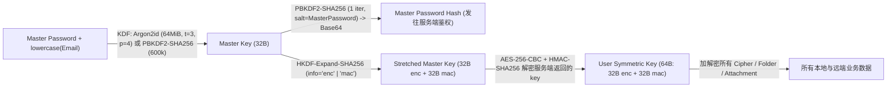
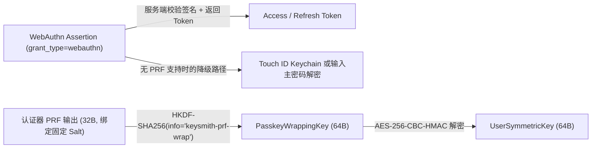

# 02 — Vaultwarden 协议适配与 KeysmithItem 数据模型

## 1. 零知识密码学协议（Bitwarden / Vaultwarden 兼容）

虽然客户端 UI 与数据模型完全按 1Password 重构，但**认证握手、密钥体系与密文信封格式 100% 遵循 Vaultwarden 协议**，确保服务器无需任何修改即可完成注册、登录、2FA、多端同步与密钥轮换。

### 1.1 密钥派生层级



**关键实现细节**：
* Email 在作为 KDF Salt 前必须做 `trim().to_lowercase()`。
* 推荐使用 **Argon2id**（`kdf = 1`，`kdfIterations = 3`，`kdfMemory = 64` MB，`kdfParallelism = 4`），新建账户默认使用 Argon2id；同时完整支持传统 **PBKDF2-SHA256**（`kdf = 0`，`kdfIterations >= 600_000`）。
* `Master Key`（32B）**不能直接用于加密数据**，必须经 `HKDF-SHA256::expand`（无 Extract 阶段，直接以 `Master Key` 作为 PRK）分别用 `info = b"enc"` 和 `info = b"mac"` 扩出两个 32 字节子密钥，拼成 64 字节 `Stretched Master Key`。

### 1.2 `EncString` 格式规范（Type 2）

所有加密字符串统一采用 Bitwarden Type 2 格式：

```text
2.<iv_base64>|<ciphertext_base64>|<mac_base64>
```

* `2.`：算法标识（`2` = `AesCbc256_HmacSha256_B64`）。
* `iv`：16 字节 CSPRNG 随机 IV。
* `ciphertext`：使用 `enc_key`（32B）与随机 `iv` 对 UTF-8 明文做 **AES-256-CBC（PKCS#7 Padding）** 加密。
* `mac`：使用 `mac_key`（32B）计算 `HMAC-SHA256(iv_bytes || ciphertext_bytes)`（注意是对原始二进制拼接计算，不是对 Base64 字符串计算）。
* **解密流程**：拆分三段 Base64 解码 -> 使用 `subtle::ConstantTimeEq` 校验 `HMAC-SHA256(iv || ct) == mac` -> 校验通过后再执行 AES-256-CBC 解密。

> **本地密钥校验器（Local Unlock Verifier）**：本地解锁验证主密码时，用派生出的 `Stretched Master Key` 尝试解密 SQLite 中缓存的 `protected_symmetric_key`；HMAC 校验与解密成功即证明主密码正确，完全无需联网。

### 1.3 认证与注册 API 流程

| 操作 | Endpoint | 说明 |
| :--- | :--- | :--- |
| **预登录** | `POST /identity/accounts/prelogin` | 入参 `{ "email": "..." }`；返回 `{ kdf, kdfIterations, kdfMemory, kdfParallelism }` |
| **新注册（VW 1.32+）** | `POST /identity/accounts/register/send-verification-email` -> `POST /identity/accounts/register/finish` | 本地 Docker 设置 `SIGNUPS_VERIFY=false` 时可直接跳过邮件，或由客户端同时兼容旧版 `POST /identity/accounts/register` |
| **登录换 Token** | `POST /identity/connect/token` | `Content-Type: application/x-www-form-urlencoded`，`grant_type=password`，`scope=api offline_access`，`client_id=desktop`，需带 `Auth-Email` 请求头（Email 的无填充 Base64Url） |
| **刷新 Token** | `POST /identity/connect/token` | `grant_type=refresh_token` |

**注册时客户端生成的加密载荷**：
1. 随机生成 64 字节 `UserSymmetricKey`；
2. 用 `Stretched Master Key` 将 `UserSymmetricKey` 加密为 `key`（`EncString`）；
3. 生成 `RSA-2048` 密钥对，公钥导出 SPKI DER Base64（`keys.publicKey`），私钥导出 PKCS#8 DER 并用 `UserSymmetricKey` 加密（`keys.encryptedPrivateKey`），用于后续可能的组织共享或密文导入兼容。

### 1.4 Passkey 登录与 WebAuthn PRF 密钥派生

Keysmith 支持 **WebAuthn + PRF 扩展** 作为 Vaultwarden 账户免主密码登录与解锁机制，同时保留无 PRF 认证器的降级路径：



| 操作 | Endpoint | 说明 |
| :--- | :--- | :--- |
| **获取登录挑战** | `POST /identity/accounts/webauthn/login-options` | 返回 `challenge`、`rpId`、`allowCredentials: []`（支持 Discoverable）与 `extensions.prf.eval.first` |
| **Passkey 换 Token** | `POST /identity/connect/token` | `grant_type=webauthn`，提交 `assertion.toJSON()` 校验后返回账户 Token 与加密的 `prfWrappedUserKey` |
| **账户 Passkey 管理** | `GET / POST / PUT / DELETE /api/webauthn/credentials` | 增删改查已注册的账户认证器；所有 `id` 与 `passkeyUserId` 严格使用**无填充 Base64URL**（`[A-Za-z0-9_-]`） |

**`StoredPasskeyCredential` 服务端/本地账户凭证模型**：
* `id`（无填充 Base64URL 凭据 ID）、`passkeyUserId`（无填充 Base64URL 用户句柄）、`credentialPublicKey`、`credentialDeviceType`（`"singleDevice" | "multiDevice"`）、`credentialBackedUp`、`aaguid`（非全零时映射提供商图标与名称）、`transports`、`counter`、`registeredAt`、`lastUsedAt`、`prfEnabled`。

---

## 2. Vaultwarden 同步、CRUD 与实时推送映射

### 2.1 接口映射表

| Keysmith 概念 | Vaultwarden API | 映射细节 |
| :--- | :--- | :--- |
| **全量拉取** | `GET /api/sync?excludeDomains=true` | 返回 `profile`、`folders`、`ciphers`、`sends` |
| **Vault（保险库）** | `/api/folders` (`POST` / `PUT /{id}` / `DELETE /{id}`) | `Folder.name` 存 `EncString(VaultMetaJson)`（可携带图标/颜色，不仅限于纯名字）；`folderId = null` 映射为系统默认的 **Personal（个人）** Vault |
| **Item（条目）** | `/api/ciphers` (`POST` / `PUT /{id}`) | 统一写入 `type: 2`（SecureNote），`secureNote: { type: 0 }`；`name` 存 `EncString(title)`，`notes` 存 `EncString(ItemPayloadJson)`，`folderId` 与 `favorite` 明文结构字段保留以便服务端筛选 |
| **回收站** | `PUT /api/ciphers/{id}/delete`、`PUT /api/ciphers/{id}/restore`、`DELETE /api/ciphers/{id}` | 分别对应移入废纸篓（设置 `deletedDate`）、从废纸篓恢复、永久粉碎 |
| **附件** | `POST /api/ciphers/{id}/attachment/v2`、`GET /api/ciphers/{id}/attachment/{attId}` | 文件二进制用独立的随机 64B `AttachmentKey` 加密，文件名与 `AttachmentKey` 用 `UserSymmetricKey` 加密 |
| **实时推送** | WebSocket `wss://<host>/notifications/hub?access_token=...` | SignalR JSON 协议握手 `{"protocol":"json","version":1}\x1e`；接收 `SyncCipherCreate` / `SyncCipherUpdate` / `SyncCipherDelete` / `SyncFolder*` 后增量同步单条 Cipher |

### 2.2 本地 SQLite 离线缓存 Schema

```sql
CREATE TABLE accounts (
    id TEXT PRIMARY KEY,
    server_url TEXT NOT NULL,
    email TEXT NOT NULL,
    kdf_type INTEGER NOT NULL,
    kdf_iterations INTEGER NOT NULL,
    kdf_memory INTEGER,
    kdf_parallelism INTEGER,
    protected_symmetric_key TEXT NOT NULL,  -- EncString 密文
    encrypted_private_key TEXT,             -- EncString 密文
    public_key TEXT,
    access_token TEXT,
    refresh_token TEXT,
    last_sync_at TEXT
);

CREATE TABLE vaults (
    id TEXT PRIMARY KEY,
    account_id TEXT NOT NULL,
    name_enc TEXT NOT NULL,                 -- EncString(VaultMetaJson)
    revision_date TEXT NOT NULL,
    dirty INTEGER NOT NULL DEFAULT 0
);

CREATE TABLE ciphers (
    id TEXT PRIMARY KEY,
    account_id TEXT NOT NULL,
    folder_id TEXT,
    cipher_type INTEGER NOT NULL,
    favorite INTEGER NOT NULL DEFAULT 0,
    name_enc TEXT NOT NULL,                 -- EncString(title)
    notes_enc TEXT,                         -- EncString(ItemPayloadJson)
    raw_json TEXT NOT NULL,                 -- 完整服务端 Cipher JSON（保留附件等未知字段）
    revision_date TEXT NOT NULL,
    deleted_date TEXT,
    dirty_op TEXT                           -- NULL | 'create' | 'update' | 'trash' | 'restore' | 'delete'
);
```

### 2.3 离线编辑与同步冲突策略

* 所有增删改先写入内存解密态并**立即持久化加密后的 `ciphers` 行（标记 `dirty_op`）**，保证 UI 零等待。
* 联网后后台队列按顺序推送 `dirty_op`：
  * 若本地 `revision_date` 与服务端一致，直接覆盖并清除 `dirty_op`；
  * 若服务端在离线期间已被另一端修改（服务端 `revisionDate` 更新），**保留服务端版本，同时将本地修改另存为一条标题追加 ` (冲突副本 YYYY-MM-DD HH:mm)` 的新条目**，绝不静默丢弃用户修改。

---

## 3. `KeysmithItem Schema v1` 完整规范

### 3.1 信封约定与容错

每条 Cipher 的 `notes` 解密后是一个自描述 JSON 文档，包含魔数校验与版本号：

* `schema`: 固定为 `"keysmith.item.v1"`（用于区分普通纯文本 SecureNote）。
* **降级兜底**：若 Vaultwarden 中存在非 Keysmith 创建的旧条目（`notes` 不是合法的 `keysmith.item.v1` JSON，或 `type != 2`），客户端将其自动适配为只读/可迁移的 `SecureNote` 或 `Login` 视图展示，确保不会崩溃或丢数据。

### 3.2 Rust 领域模型定义

```rust
use serde::{Deserialize, Serialize};
use zeroize::Zeroize;

#[derive(Debug, Clone, Serialize, Deserialize)]
#[serde(rename_all = "camelCase")]
pub struct ItemPayload {
    pub schema: String,                     // "keysmith.item.v1"
    pub category: ItemCategory,
    pub subtitle: Option<String>,           // 列表副标题缓存（如主用户名/卡号后四位/IP），为空时自动推导
    pub icon: Option<ItemIcon>,
    pub tags: Vec<String>,
    pub urls: Vec<ItemUrl>,
    pub sections: Vec<ItemSection>,
    #[serde(default)]
    pub passkeys: Vec<PasskeyCredential>,   // 绑定的第三方网站 Passkey（免密登录凭据）
    pub notes: String,                      // 用户可见的富文本/Markdown 备注
    pub password_history: Vec<PasswordHistoryEntry>,
    pub watchtower: WatchtowerFlags,
    pub created_at: String,                 // RFC 3339
    pub updated_at: String,                 // RFC 3339
}

#[derive(Debug, Clone, Serialize, Deserialize)]
#[serde(rename_all = "camelCase")]
pub struct PasskeyCredential {
    pub credential_id: String,              // 无填充 Base64URL 凭据 ID
    pub rp_id: String,                      // 依赖方域名（如 github.com）
    pub rp_name: String,                    // 依赖方显示名称
    pub user_handle: String,                // 无填充 Base64URL 用户句柄
    pub user_name: String,                  // 账户名（如 cherry@example.com）
    pub user_display_name: String,
    pub algorithm: i32,                     // COSE 算法编号：-7 (ES256 P-256) / -8 (EdDSA)
    pub private_key_pkcs8: String,          // Base64 PKCS#8 私钥（随 ItemPayload 全量加密）
    pub public_key_spki: String,            // Base64 SPKI 公钥
    pub sign_count: u32,                    // 签名计数器（防重放）
    pub discoverable: bool,                 // 是否支持无用户名发现（Resident Key）
    pub aaguid: String,                     // Keysmith 认证器 AAGUID
    pub transports: Vec<String>,            // ["internal", "hybrid"]
    pub backed_up: bool,
    pub created_at: String,                 // RFC 3339
    pub last_used_at: Option<String>,       // RFC 3339
}

#[derive(Debug, Clone, Copy, PartialEq, Eq, Serialize, Deserialize)]
#[serde(rename_all = "snake_case")]
pub enum ItemCategory {
    // Phase 1 可手动新建模板（10 种）
    Login,
    Password,
    SecureNote,
    CreditCard,
    Identity,
    ApiCredential,
    Database,
    Server,
    SshKey,
    SoftwareLicense,
    // 网页 WebAuthn 被动唤起自动创建（不在工作台手动新建列表中）
    Passkey,
    // Phase 2 扩展（8 种）
    BankAccount,
    CryptoWallet,
    WirelessRouter,
    Passport,
    DriverLicense,
    Membership,
    MedicalRecord,
    Document,
}

#[derive(Debug, Clone, Serialize, Deserialize)]
#[serde(rename_all = "camelCase")]
pub struct ItemSection {
    pub id: String,                         // UUID v4，支持拖拽排序与稳定引用
    pub title: String,                      // 空字符串表示顶部主区域（无分组标题）
    pub fields: Vec<ItemField>,
}

#[derive(Debug, Clone, Serialize, Deserialize)]
#[serde(rename_all = "camelCase")]
pub struct ItemField {
    pub id: String,
    pub label: String,
    pub field_type: FieldType,
    pub value: String,
    #[serde(default)]
    pub sensitive: bool,                    // true: 默认掩码显示 + 复制走 Concealed 剪贴板 + 支持三色高亮
    #[serde(default)]
    pub copyable: bool,
    pub purpose: Option<FieldPurpose>,      // 语义用途标记（如 username / password / totp / pin）
}

#[derive(Debug, Clone, Copy, PartialEq, Eq, Serialize, Deserialize)]
#[serde(rename_all = "snake_case")]
pub enum FieldType {
    Text,
    Password,
    Email,
    Url,
    Totp,
    Date,
    MonthYear,                              // YYYY-MM，如信用卡有效期
    Phone,
    Number,
    Address,
    Multiline,
    SshPrivateKey,
    SshPublicKey,
    KeyValue,
}

#[derive(Debug, Clone, Copy, PartialEq, Eq, Serialize, Deserialize)]
#[serde(rename_all = "snake_case")]
pub enum FieldPurpose {
    Username,
    Password,
    Totp,
    CardNumber,
    CardCvv,
    CardExpiry,
    Pin,
    RecoveryCodes,
}

#[derive(Debug, Clone, Serialize, Deserialize)]
#[serde(rename_all = "camelCase")]
pub struct ItemUrl {
    pub id: String,
    pub uri: String,
    pub label: Option<String>,
    pub match_rule: UrlMatchRule,
}

#[derive(Debug, Clone, Copy, PartialEq, Eq, Serialize, Deserialize)]
#[serde(rename_all = "snake_case")]
pub enum UrlMatchRule {
    Domain,                                 // 主域匹配（默认，对齐 1Password）
    Host,                                   // 精确主机+端口
    StartsWith,
    Exact,
    Never,                                  // 仅作跳转链接，不触发自动填充
}

#[derive(Debug, Clone, Serialize, Deserialize)]
#[serde(tag = "kind", rename_all = "snake_case")]
pub enum ItemIcon {
    Domain { host: String },                // 根据主域名加载高分辨率 Favicon
    Preset { name: String, color: String }, // 内置图标 + 品牌色
}

#[derive(Debug, Clone, Serialize, Deserialize)]
#[serde(rename_all = "camelCase")]
pub struct PasswordHistoryEntry {
    pub value: String,
    pub changed_at: String,
}

#[derive(Debug, Clone, Default, Serialize, Deserialize)]
#[serde(rename_all = "camelCase")]
pub struct WatchtowerFlags {
    pub ignore_weak: bool,
    pub ignore_reused: bool,
    pub ignore_missing_2fa: bool,
    pub ignore_unsecured_url: bool,
}
```

### 3.3 `ItemPayload` JSON 示例（GitHub 登录条目）

```json
{
  "schema": "keysmith.item.v1",
  "category": "login",
  "subtitle": "cherry@example.com",
  "icon": { "kind": "domain", "host": "github.com" },
  "tags": ["开发", "常用"],
  "urls": [
    {
      "id": "u-1",
      "uri": "https://github.com/login",
      "label": "登录页",
      "matchRule": "domain"
    }
  ],
  "sections": [
    {
      "id": "sec-primary",
      "title": "",
      "fields": [
        {
          "id": "f-1",
          "label": "用户名",
          "fieldType": "text",
          "value": "cherry@example.com",
          "sensitive": false,
          "copyable": true,
          "purpose": "username"
        },
        {
          "id": "f-2",
          "label": "密码",
          "fieldType": "password",
          "value": "K9#mP2$vL8qR4@xW",
          "sensitive": true,
          "copyable": true,
          "purpose": "password"
        },
        {
          "id": "f-3",
          "label": "一次性密码",
          "fieldType": "totp",
          "value": "otpauth://totp/GitHub:cherry?secret=JBSWY3DPEHPK3PXP&issuer=GitHub",
          "sensitive": true,
          "copyable": true,
          "purpose": "totp"
        }
      ]
    },
    {
      "id": "sec-recovery",
      "title": "恢复与令牌",
      "fields": [
        {
          "id": "f-4",
          "label": "恢复代码",
          "fieldType": "multiline",
          "value": "a1b2-c3d4\ne5f6-g7h8",
          "sensitive": true,
          "copyable": true,
          "purpose": "recovery_codes"
        }
      ]
    }
  ],
  "passkeys": [
    {
      "credentialId": "Z2l0aHViLXBhc3NrZXktY3JlZC0wMQ",
      "rpId": "github.com",
      "rpName": "GitHub",
      "userHandle": "Y2hlcnJ5LWdpdGh1Yi11aWQtMDE",
      "userName": "cherry@example.com",
      "userDisplayName": "Cherry Wang",
      "algorithm": -7,
      "privateKeyPkcs8": "<Base64 PKCS8 Private Key>",
      "publicKeySpki": "<Base64 SPKI Public Key>",
      "signCount": 14,
      "discoverable": true,
      "aaguid": "6a8f4c12-9b3e-47a1-8c2d-5e1f9a0b3c4d",
      "transports": ["internal", "hybrid"],
      "backedUp": true,
      "createdAt": "2026-06-12T09:00:00Z",
      "lastUsedAt": "2026-11-22T14:20:00Z"
    }
  ],
  "notes": "个人主力代码托管账号，已绑定硬件安全密钥。",
  "passwordHistory": [
    { "value": "OldPass_2025!99", "changedAt": "2025-12-01T10:00:00Z" }
  ],
  "watchtower": {
    "ignoreWeak": false,
    "ignoreReused": false,
    "ignoreMissing2fa": false,
    "ignoreUnsecuredUrl": false
  },
  "createdAt": "2025-12-01T10:00:00Z",
  "updatedAt": "2026-11-20T08:30:00Z"
}
```

---

## 4. Phase 1 模板默认字段矩阵

新建条目时由 `domain::templates` 自动预填充对应的 `sections` 与 `fields`，用户可在编辑器中自由删改或新增自定义区块：

| 模板 (`ItemCategory`) | 主区默认字段 | 扩展分组与默认字段 |
| :--- | :--- | :--- |
| `login` 登录 | 用户名 (`username`)、密码 (`password`)、一次性密码 (`totp`)、网址 (`urls`) | 支持一键添加“恢复代码”、“安全问题”分组 |
| `password` 密码 | 密码 (`password`)、网址 (`urls`) | — |
| `secure_note` 安全笔记 | 仅大文本框 `notes`（支持 Markdown 预览） | 支持随时附加自定义字段分组 |
| `credit_card` 银行卡 | 持卡人、卡号 (`card_number`, sensitive)、有效期 (`month_year`)、安全码 CVV (`card_cvv`, sensitive)、卡类型 | **账单信息**：银行名称、ATM PIN (`pin`, sensitive)、客服电话 |
| `identity` 身份信息 | 名、姓、性别、出生日期、公司/职位 | **联系方式**：邮箱、手机、地址；**证件号**：身份证/社保号 (sensitive) |
| `api_credential` API 凭证 | 用户名/AppID、API Key (sensitive)、API Secret (sensitive)、接口基址 (`url`) | **权限与有效期**：Scope、过期时间 (`date`) |
| `database` 数据库 | 类型（PostgreSQL/MySQL/Redis 等）、主机、端口、数据库名、用户名、密码 (sensitive) | **连接串**：Connection URI (sensitive)、SSL 模式 |
| `server` 服务器 | 主机/IP、端口、用户名、密码 (sensitive)、Root/Admin 密码 (sensitive) | **托管商**：面板网址、控制台账号、所在机房 |
| `ssh_key` SSH 密钥 | 公钥 (`ssh_public_key`)、私钥 (`ssh_private_key`, sensitive)、密钥口令 Passphrase (sensitive)、指纹 | 自动支持生成 `Ed25519` 密钥对（Phase 2） |
| `software_license` 软件许可 | 许可证密钥 (`license_key`, sensitive)、注册邮箱、版本 | **购买信息**：购买日期、到期日期 (`date`)、订单号、下载页 (`url`) |
| `passkey` 通行密钥（仅自动生成） | 依赖方域名 (`rp_id`)、依赖方名称、账户名 (`username`)、关联站点 (`urls`) | **被动创建**：仅当无同域 `Login` 可绑定且用户通过网站 WebAuthn 唤起保存时自动创建，只读展示 `PasskeyCredential` |

---

## 5. Watchtower 本地安全审计规则

所有审计计算均在解锁后的内存态由 `keysmith-core::watchtower` 本地执行：

| 审计项 | 判定规则 | 严重级别 | 豁免方式 |
| :--- | :--- | :--- | :--- |
| **弱密码** | 对所有 `purpose == password` 且非空字段运行 `zxcvbn`，`score < 3`（即 0/1/2 分） | 高危（红） | `watchtower.ignoreWeak = true` |
| **重复使用的密码** | 对非空密码做内存加盐 BLAKE3 哈希分桶，桶内条目数 `>= 2` 全部标出 | 高危（红） | `watchtower.ignoreReused = true` |
| **未启用双重验证（2FA / Passkey）** | `category == login` 且存在有效网址，但条目内无 `fieldType == totp` 字段且 `passkeys` 为空 | 中危（琥珀） | 绑定 Passkey / 添加 TOTP 或 `watchtower.ignoreMissing2fa = true` |
| **不安全连接（HTTP）** | `urls` 中存在 `http://`（排除 `localhost`、`127.0.0.1`、`*.local` 与内网网段） | 低危（黄） | `watchtower.ignoreUnsecuredUrl = true` |
| **即将过期 / 已过期** | `credit_card` 的 `card_expiry` 或 `software_license` / 证件的到期日在 30 天内或已过期 | 提示（蓝） | 更新日期或移入废纸篓 |
| **泄露密码检测（可选）** | 仅当用户显式点击“检查已泄露密码”时，本地计算密码 `SHA-1` 并只发送前 5 位十六进制至 `api.pwnedpasswords.com/range/{prefix}`（k-匿名，永不发送完整哈希或明文） | 极危（深红） | 更换密码并保留历史记录 |
