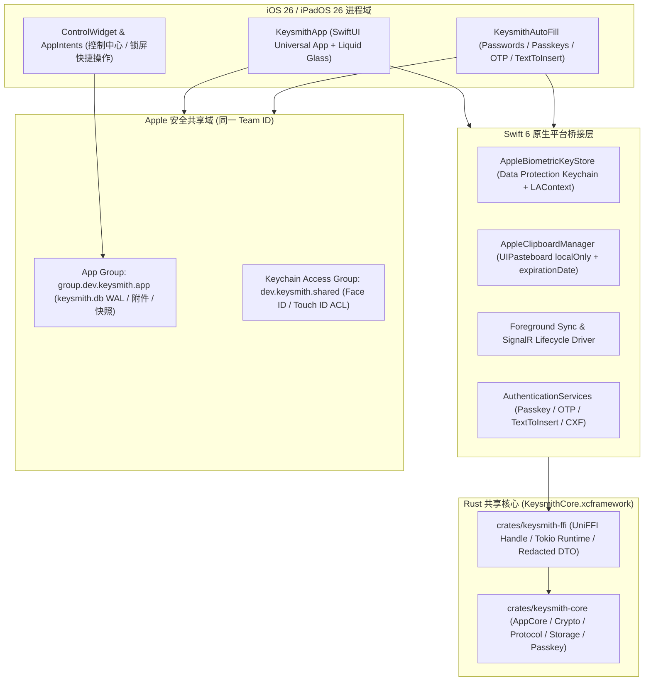
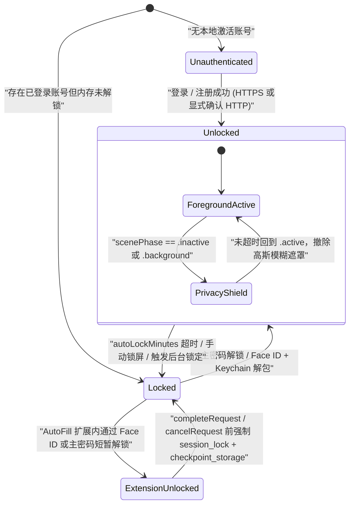
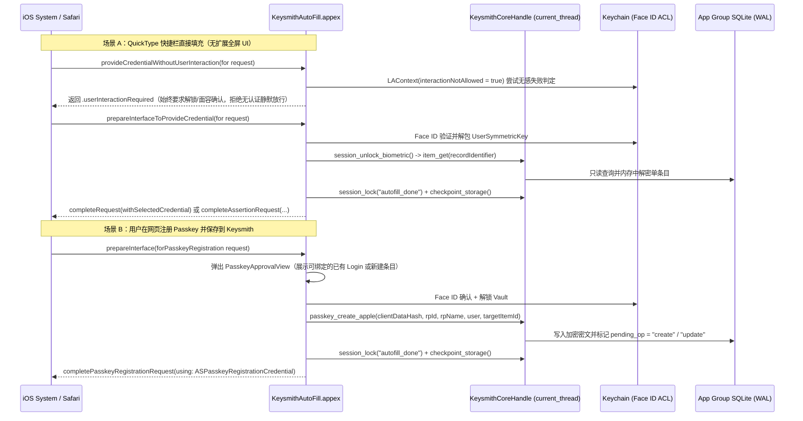

# 05 — iOS & iPadOS 客户端架构与交互设计规范

> **定位**：基于现有 `crates/keysmith-core`（Vaultwarden 零知识同步、加解密、Passkey、TOTP、Watchtower、Send）的 **iPhone + iPad 通用原生 App** 与系统级 **AutoFill / Passkey 提供程序扩展**。  
> **技术路线**：`Swift 6 + SwiftUI`（基于 **iOS 26 / iPadOS 26** 最新原生 API 与 Liquid Glass 设计语言）+ `crates/keysmith-ffi`（UniFFI 导出 `KeysmithCore.xcframework`）。

---

## 1. 目标定位与技术选型决策

### 1.1 系统版本基线与能力矩阵

直接以 **iOS 26.0 / iPadOS 26.0**（Xcode 26 SDK + Swift 6 严格并发模式）作为最低部署目标，不背负历史版本 `#available` 分支包袱，完整启用最新原生能力：

| 维度 | 选型决策 | 释放的最新原生能力 |
| :--- | :--- | :--- |
| **最低部署目标** | **iOS 26.0 / iPadOS 26.0** | 零旧版本兼容胶水代码；直接采用 Swift 6 并发安全模型与最新 `AuthenticationServices` / SwiftUI API |
| **视觉与导航体系** | **Liquid Glass 原生材质 + 现代导航容器** | 与桌面端 macOS Liquid Glass 统一：`glassEffect`、`GlassEffectContainer`、iPadOS 26 原生分栏工具栏与自由窗口（外接键盘按需呼出 `CommandMenu`）、`.sidebarAdaptable` `TabView`、`Tab(role: .search)` 与 `.tabViewBottomAccessory` |
| **完整 AutoFill 栈** | **`KeysmithAutoFill`（`ASCredentialProviderViewController`）** | 无条件开启 **密码填充（`ProvidesPasswords`）**、**Passkey 创建与断言（`ProvidesPasskeys`）**、**系统原生验证码键盘填充（`ProvidesOneTimeCodes`）**、**任意文本框注入信用卡/身份/文本（`ProvidesTextToInsert`）** |
| **生态凭证互迁** | **FIDO Credential Exchange（CXF）** | 原生接入 `ASCredentialImportManager` / `ASCredentialExportManager`，支持与 Apple「密码」、1Password 等应用安全加密互导密码与 Passkey |
| **系统级快捷入口** | **`ControlWidget` + `AppIntents`** | 支持 iOS 控制中心与锁屏快捷按钮（一键快速检索、扫码导入 2FA、立即锁定保险库） |

### 1.2 为什么选择 SwiftUI + UniFFI，而不是 Tauri Mobile？

1. **AutoFill 扩展的硬性内存上限（约 30–50 MB）**：
   * 在 Safari、系统设置或其他第三方 App 内唤起自动填充与 Passkey 面板时，iOS 会拉起独立进程 `KeysmithAutoFill.appex` 并施加约 **30–50 MB** 的物理内存上限（超出即触发 Jetsam 闪退）。
   * Tauri Mobile 需要拉起完整的 `WKWebView` 进程，单 WebView 开销即接近或超过扩展进程限额；而 **SwiftUI + 静态链接 `KeysmithCore.xcframework`** 启动时间 < 120 ms，峰值内存可控在 **25 MB 以内**。
2. **一举两得打通未来 Android**：
   * 通过 `crates/keysmith-ffi` 的 UniFFI 定义暴露给 Swift 的同一套强类型契约，后续接入 Android（Kotlin + JNI）可直接复用 95% 的桥接代码与错误模型。
3. **无条件使用最新 Apple 原生体验**：
   * 无需做老系统降级兼容，直接把 Liquid Glass、`ProvidesTextToInsert`、`ASOneTimeCodeCredentialIdentity`、FIDO Credential Exchange、iPadOS 26 自由多窗口/原生分栏工具栏以及 `ControlWidget` 全部做满。

### 1.3 总体分层架构



---

## 2. Monorepo 目录规划与构建流水线

### 2.1 目录结构规划

```text
Keysmith/
├── Cargo.toml                         # 新增 "crates/keysmith-ffi" 到 workspace（或条件排除桌面依赖）
├── crates/
│   ├── keysmith-core/                 # 现有共享零知识内核（最小向后兼容增强）
│   └── keysmith-ffi/                  # UniFFI 跨端导出层（服务 iOS / iPadOS 与未来 Android）
│       ├── Cargo.toml                 # crate-type = ["staticlib", "cdylib", "lib"]
│       ├── uniffi.toml
│       └── src/
│           ├── lib.rs                 # UniFFI scafolding + KeysmithCoreHandle + 回调接口
│           ├── mapper.rs              # keysmith-core Domain/Error <-> FFI Record/Enum 映射
│           └── runtime.rs             # Tokio runtime 配置（主 App multi_thread / 扩展 current_thread）
├── scripts/
│   └── build-ios-xcframework.sh       # 编译 aarch64-apple-ios / ios-sim，导出 Swift + XCFramework
└── apps/
    └── ios/
        ├── project.yml                # XcodeGen 工程清单（本机已预装 xcodegen）
        ├── Shared/                    # 主 App 与 AutoFill 扩展共享 Swift 代码
        │   ├── AppConfig.swift        # App Group / Keychain Access Group / Bundle ID 常量
        │   ├── AppleBiometricKeyStore.swift
        │   ├── AppleClipboardManager.swift
        │   ├── CoreContainer.swift    # 构建共享 keysmith.db 路径与 KeysmithCoreHandle
        │   └── Bindings/              # 脚本生成的 KeysmithFFI.swift + modulemap（.gitignore 或锁定生成）
        ├── KeysmithApp/               # iPhone + iPad 通用主程序
        │   ├── App/                   # App 入口、ScenePhase 隐私遮罩、自动锁定调度
        │   ├── Features/
        │   │   ├── Auth/              # 登录 / 注册（非回环 HTTP 告警、PBKDF2 提醒、12 位强度校验）
        │   │   ├── Lock/              # Face ID / Touch ID & 主密码解锁面板
        │   │   ├── Vault/             # iPad 三栏 NavigationSplitView / iPhone 列表与分类
        │   │   ├── Item/              # 条目详情（三色密码高亮、Large Type、常用字段快捷添加、编辑）
        │   │   ├── Totp/              # 倒计时令牌 + AVFoundation 相机扫码 / 相册识别
        │   │   ├── Generator/         # 密码/短语/掩码邮箱生成器
        │   │   ├── Watchtower/        # 安全守望台仪表盘
        │   │   ├── Send/              # Send 文本/文件分享管理
        │   │   └── Settings/          # 多账号、安全开关、同步状态、AutoFill 指引
        │   ├── Resources/             # 8 国语言 Localizable.xcstrings（与桌面端文案对齐）
        │   └── KeysmithApp.entitlements
        └── KeysmithAutoFill/          # 系统自动填充与 Passkey 扩展
            ├── CredentialProviderViewController.swift
            ├── AutoFillSessionView.swift
            ├── PasskeyApprovalView.swift
            ├── Info.plist
            └── KeysmithAutoFill.entitlements
```

### 2.2 `XCFramework` 构建流水线与本机前置环境

当前开发环境探测结果：已安装 `xcodegen`（`/opt/homebrew/bin/xcodegen`）与 `swift`，但 `xcode-select` 当前指向 `CommandLineTools`，且 Rust 仅安装了 `aarch64-apple-darwin`。进入实际编码阶段需先完成一次性环境准备：

```bash
# 1. 安装完整版 Xcode 并切换开发者目录
sudo xcode-select -s /Applications/Xcode.app/Contents/Developer

# 2. 添加 iOS 真机与 Apple Silicon 模拟器编译目标
rustup target add aarch64-apple-ios aarch64-apple-ios-sim
```

`scripts/build-ios-xcframework.sh` 的职责与流程：
1. 按模式（`--debug` / `--release`）为 `aarch64-apple-ios` 与 `aarch64-apple-ios-sim` 编译 `libkeysmith_ffi.a`；
2. 通过 `uniffi-bindgen generate --library ... --language swift` 生成 `KeysmithFFI.swift`、`keysmithFFI.h` 与 `keysmithFFI.modulemap` 放入 `apps/ios/Shared/Bindings/`；
3. 使用 `xcodebuild -create-xcframework` 打包合并为 `apps/ios/Frameworks/KeysmithCore.xcframework`；
4. 调用 `xcodegen generate --spec apps/ios/project.yml` 生成最新 `Keysmith.xcodeproj`。

---

## 3. `keysmith-core` 轻量适配与 `crates/keysmith-ffi` 契约

现有 [crates/keysmith-core/Cargo.toml](../crates/keysmith-core/Cargo.toml) 已采用 `rustls-tls`、`rusqlite (bundled)` 与纯 Rust 密码学原语，无需改造核心加密链路，仅需对以下 3 个点做向后兼容的轻量增强：

### 3.1 `keysmith-core` 最小增强清单

| 增强点 | 现状（当前仓库） | iOS/iPadOS 所需增量改造 |
| :--- | :--- | :--- |
| **1. 客户端 User-Agent 可配置** | `VaultwardenClient::new()` 固定为 `"Keysmith/0.1.4 (macOS; Tauri)"`（`protocol/mod.rs`） | 增加 `AppCore::with_storage_and_client_info(..., user_agent)` 或配置项，iOS 传入 `"Keysmith/0.1.4 (iOS; SwiftUI)"` / `"Keysmith/0.1.4 (iPadOS; SwiftUI)"` |
| **2. 跨进程共享 SQLite WAL 安全** | `storage/mod.rs` 已启用 `journal_mode = WAL`，尚未显式设置 `busy_timeout` | 在 `Storage::open` 增加 `PRAGMA busy_timeout = 5000;`，防止主 App 与 AutoFill 扩展同时读写共享容器 `keysmith.db` 时出现 `SQLITE_BUSY`；iOS 目录初始化时同时设置 `NSFileProtectionCompleteUntilFirstUserAuthentication` 与 `isExcludedFromBackup = true`（阻止密文库被明文云备份策略干扰，一切同步走 Vaultwarden） |
| **3. Apple 原生 Passkey `clientDataHash` 签名接口** | `passkey.rs` 现有 `create_passkey_credential` / `assert_passkey_credential` 从 `origin` + `challenge` 拼接 `clientDataJSON` 再做 SHA-256（面向浏览器扩展） | Apple `ASPasskeyCredentialRequest` 直接下发 **32 字节 `clientDataHash`**（系统已替 Relying Party 构造并校验了 origin）。在 `passkey.rs` 新增 `create_passkey_with_client_data_hash` 与 `assert_passkey_with_client_data_hash`，直接对 Apple 提供的 `clientDataHash` 与编码后的 `authenticatorData` 签名（复用现有的 ES256/Ed25519 密钥生成、COSE 编码、PRF `hmac-secret` 派生及 `sign_count` 递增逻辑） |
| **4. 移动端精细自动锁定粒度（秒级）** | `SessionState` 与 `SessionPreferencesPatch` 当前仅支持 `auto_lock_minutes: u32` | 为兼容移动端 1Password / Bitwarden 常见的 **立即 / 15 秒 / 30 秒 / 1 分钟 / 5 分钟 / 15 分钟 / 30 分钟 / 永不** 等选项，在 `SessionPreferencesPatch` 中向后兼容增加 `auto_lock_seconds: Option<u32>`（保留 `auto_lock_minutes` 兼容桌面端现有调用），`check_auto_lock` 优先按秒级阈值判断 |

### 3.2 UniFFI 回调接口与核心句柄设计

`crates/keysmith-ffi` 使用 **UniFFI Callback Interface** 对接 [traits.rs](../crates/keysmith-core/src/traits.rs)：

```text
[callback interface] FfiBiometricKeyStore:
  - is_available() -> bool
  - save_unlock_key(account_id: String, key: Vec<u8>) -> Result<(), FfiError>
  - load_unlock_key(account_id: String, reason: String) -> Result<Vec<u8>, FfiError>
  - delete_unlock_key(account_id: String) -> Result<(), FfiError>
  - verify_user(reason: String) -> Result<(), FfiError>

[callback interface] FfiClipboardManager:
  - copy_secret(text: String, label: String, is_sensitive: bool, clear_after_secs: u64) -> Result<(), FfiError>
  - clear_now() -> Result<(), FfiError>
```

> **FFI 零知识边界红线**：
> 1. 除经 `BiometricKeyStore` 写入系统 Data Protection Keychain 的 64 字节 `UserSymmetricKey` 外，主密钥、`StretchedMasterKey`、会话 OAuth 明文令牌与 Passkey 私钥（`privateKeyPkcs8`）**禁止跨越 FFI 返回给 Swift/UI 层**；
> 2. 所有 FFI `Error` 枚举严格复用 `CoreError` 分类（`Authentication`、`InvalidMasterPassword`、`TwoFactorRequired`、`Biometric`、`Validation`、`Network`、`Locked` 等），避免泄露内部密钥或路径细节；
> 3. `KeysmithFFI.initialize(dbPath, biometricStore, clipboardManager, isExtension: Bool, userAgent: String)` 在主 App 中使用多线程 Tokio runtime，在 AutoFill 扩展中以 `isExtension = true` 初始化单线程 `current_thread` runtime 以控制线程与内存占用。

### 3.3 `KeysmithCoreHandle` 与现有 `AppCore` 映射清单

| 功能域 | `KeysmithCoreHandle` 方法（UniFFI） | 对应 `crates/keysmith-core` 实现 |
| :--- | :--- | :--- |
| **认证与协议** | `auth_check_server(server_url, allow_insecure_http)` / `auth_prelogin(...)` / `auth_login(...)` / `auth_register(...)` / `auth_logout(clear_local_cache)` | `AppCore::auth_*_with_policy`、`auth_logout` |
| **会话与锁** | `session_get_state()` / `session_update_preferences(patch)` / `session_unlock_password(pw)` / `session_unlock_biometric()` / `session_verify_user_presence(reason)` / `session_lock(reason)` / `session_touch_activity()` / `check_auto_lock()` | `AppCore::session_*`、`check_auto_lock` |
| **多账号** | `account_list()` / `account_switch(account_id)` / `account_update_profile(display_name)` | `AppCore::account_*` |
| **Vault & 条目** | `vault_list/create/rename/set_travel_safe/delete`、`item_list(filter)` / `item_get(id)` / `item_create(draft)` / `item_update(id, draft)` / `item_trash/restore/delete_permanent/empty_trash` | `AppCore::vault_*`、`AppCore::item_*` |
| **同步与实时推送** | `sync_get_status()` / `sync_now()` / `check_and_sync_if_changed(sync_on_unknown)` / `start_signalr_listener(listener)` / `stop_signalr_listener()` | `AppCore::sync_*`、`signalr_credentials_with_policy()` + `run_signalr_session_with_policy()` |
| **TOTP & 生成器** | `totp_compute(secret_or_uri)` / `totp_parse_qr_image(bytes_b64)` / `generator_generate(opts)` / `generator_generate_masked_email()` / `generator_history_*` | `AppCore::totp_*`、`AppCore::generator_*` |
| **Passkey / Text 扩展** | `passkey_list_for_rp(rp_id, allow_creds)` / `passkey_create_apple(...)` / `passkey_assert_apple(...)` / `text_insert_candidates(query)` | 新增 `passkey.rs` `*_with_client_data_hash` 与信用卡/身份/备注候选摘要查询，适配 `ProvidesPasskeys` 与 `ProvidesTextToInsert` |
| **安全体检 / Send / 互迁** | `watchtower_scan(check_hibp)` / `send_*` / `attachment_*` / `import_cxf_bundle(json)` / `export_cxf_bundle()` / `vault_import/export*` | `AppCore::watchtower_*`、`send_*`、`attachment_*`、`snapshot_*` 与 FIDO CXF 凭证互迁编解码器 |
| **应用设置与持久化** | `app_settings_get()` / `app_settings_update(patch)` / `favicon_fetch(host)` / `checkpoint_storage()` | `AppCore::app_settings_*`、`favicon_fetch`、`checkpoint_storage` |

---

## 4. iOS / iPadOS 安全边界与生命周期状态机

Keysmith 桌面端刚刚完成的全部安全基线将在 iOS / iPadOS 上无条件继承，并与 iOS 系统保护机制深度整合：

1. **Keychain + Face ID / Touch ID 硬件绑定（无 ad-hoc `-34018` 回退问题）**：
   * 在主 App 与 `KeysmithAutoFill` 均配置相同的 **Keychain Access Group**（`$(AppIdentifierPrefix)dev.keysmith.shared`）后，使用 `SecAccessControlCreateWithFlags` 创建 ACL：
     * `kSecAttrAccessibleWhenUnlockedThisDeviceOnly`（仅解锁后可用、禁止 iCloud Keychain / iTunes 迁移备份）
     * `kSecAccessControlBiometryCurrentSet`（设备录入/删除面容或指纹后自动失效，强制回退主密码重绑）
     * `kSecAttrAccessGroup` 共享组（主 App 与 AutoFill 扩展共用解锁绑定，一次启用两端生效，遵循 `biometricMaxDays` 超期回退主密码策略）。
2. **文件权限与备份排除**：
   * 共享 App Group 目录 `/private/var/mobile/Containers/Shared/AppGroup/<uuid>/` 创建即设置 `FileProtectionType.completeUntilFirstUserAuthentication`（保证锁定但已首次开机解锁后的 AutoFill 列表索引读取正常，同时全盘受 iOS 硬件文件加密保护）；
   * 对 `keysmith.db` 及其 `-wal`/`-shm`、本地加密快照和附件缓存设置 `URLResourceValues.isExcludedFromBackup = true`，防止未受开发者控制的 iCloud 整机备份混入 SQLite 镜像。
   * 数据库中 `access_token` / `refresh_token` 复用 `keysmith-core` 的 EncString Type 2 加密落盘，未解锁时任何后台任务绝不读取明文会话令牌。
3. **生命周期状态机与隐私保护**：



4. **隐私细节约束**：
   * **多任务快照防偷窥**：当 `scenePhase` 进入 `.inactive` 或 `.background` 时，最顶层立即覆盖高斯模糊 + Keysmith 徽标遮罩视图，防止敏感字段留在系统任务切换截图缓存中；同时触发 `checkpoint_storage()`。
   * **剪贴板自动清除**：`AppleClipboardManager` 使用 `UIPasteboard.general.setItems([[UIPasteboard.typeAutomatic: text]], options: [.localOnly: true, .expirationDate: Date().addingTimeInterval(Double(secs))])`；`is_sensitive = true` 时禁止 Universal Clipboard（Handoff 跨设备同步剪贴板），且由系统到期自动抹除，主 App 前台保留倒计时胶囊支持“立即清空”。
   * **防截屏/录屏护栏（`screenCaptureProtected`）**：开启该设置后，通过 `UITextField` 安全渲染容器（`isSecureTextEntry = true` 层次宿主或敏感字段按需遮罩）与监听 `UIScreen.capturedDidChangeNotification` / `UIScreen.isCaptured` 在检测到录屏或投屏时自动遮罩所有敏感密码、OTP 与恢复密钥并显示提示横幅。
   * **网络与认证基线继承**：沿用桌面端规则——非回环 `http://` 需要显式风险提示+确认勾选；服务端返回 PBKDF2 迭代 `< 600,000` 显示橙色升级建议；注册强校验主密码至少 12 位且包含至少两类字符；Favicon 请求继续经 `validate_favicon_host` 与 Vaultwarden 服务端代理完成。

---

## 5. 系统自动填充与 Passkey 扩展（`KeysmithAutoFill`）

### 5.1 扩展能力声明（`Info.plist`）

`KeysmithAutoFill` 在 `NSExtensionAttributes.ASCredentialProviderExtensionCapabilities` 中声明全部五项现代能力：

| Key | Value | 作用 |
| :--- | :--- | :--- |
| `ProvidesPasswords` | `YES` | 为系统键盘栏与密码填充面板提供账号密码条目 |
| `ProvidesPasskeys` | `YES` | 支持无密码登录（Passkey Assertion）与在 Safari / App 内创建新通行密钥（Passkey Registration） |
| `ProvidesOneTimeCodes` | `YES` | 原生提供 6 位 TOTP 动态验证码自动填充（通过 `ASOneTimeCodeCredentialIdentity` 直接推荐至 QuickType 栏） |
| `ProvidesTextToInsert` | `YES` | 允许在任意文本框（例如支付页、快递表单、终端等）通过系统 AutoFill 直接插入信用卡卡号/CVV、身份证件、API Token 或安全备注 |
| `ShowsConfigurationUI` | `YES` | 在系统「设置 → 通用 → 自动填充与密码 → Keysmith」允许用户快速前往解锁、同步和检查状态 |

### 5.2 `ASCredentialIdentityStore` 隐私索引同步策略

* 每当主 App 完成 `sync_now()`、新建/修改/删除/还原条目、切换账号或开启/关闭 Travel Mode 后，主 App 从内存中的已解密视图生成**非敏感索引切片**并更新 `ASCredentialIdentityStore.shared`：
  * **Password 条目**：仅写入 `ASPasswordCredentialIdentity`（`serviceIdentifier` + `user` + `recordIdentifier: item_id`，**绝不写入密码与 notes**）；
  * **Passkey 条目**：仅写入 `ASPasskeyCredentialIdentity`（`relyingPartyIdentifier` + `userName` + `credentialID` + `userHandle` + `recordIdentifier`）；
  * **TOTP 条目**：直接写入 `ASOneTimeCodeCredentialIdentity`，实现原生验证码键盘推荐与自动填入；
  * **登出/清除本地缓存**：调用 `ASCredentialIdentityStore.shared.removeAllCredentialIdentities()` 清空系统凭证缓存。

### 5.3 扩展交互时序图（快速填充与 Passkey 创建/断言）



### 5.4 AutoFill 扩展内存与生命周期严格管控

1. **禁止在扩展中启动常驻任务**：扩展进程内严禁开启 SignalR WebSocket 长连接、禁止预拉取图标（Favicon）或触发全量 Watchtower 扫描。
2. **用完即锁 + 即刻 Checkpoint**：每次填充、生成、查看验证码或创建 Passkey 结束（或用户点击取消）时，在调用 `extensionContext.complete*` / `cancelRequest` 之前**必须**同步执行 `core.session_lock("extension_complete")` 与 `core.checkpoint_storage()`，防止 `-wal` 滞留未落盘页，并在数毫秒内释放全部解密内存。
3. **在线同步解耦**：扩展在完成 Passkey 注册后仅在共享 SQLite 写入加密条目及 `pending_op`；当用户下次切回主 App 并处于已解锁状态时，由主 App 的同步引擎自动将该 Passkey 推送至 Vaultwarden，或在设置页提示“有 1 项待上传通行密钥，打开主 App 即可自动同步”。

### 5.5 系统级安全凭证互迁（FIDO CXF）

* 借助 `ASCredentialImportManager` 与 `ASCredentialExportManager`（基于 FIDO Credential Exchange Format 标准）：
  * **一键导入**：支持直接接收 Apple「密码」或其他兼容管理器通过系统安全通道传入的账号与 Passkey（含私钥封装），解密后通过 `keysmith-core` 转加密写入本地 Vaultwarden 保险库与同步队列；
  * **安全导出**：用户经 Face ID 复核确认后，可通过系统级加密通道导出指定凭证（含 Passkey），无需落地明文 CSV/JSON 中转文件。

---

## 6. iPhone 与 iPadOS 信息架构及 Liquid Glass 交互规范

### 6.1 跨平台统一视觉 Token（延续 [03-ui-and-interaction.md](./03-ui-and-interaction.md)）

| 视觉规范项 | iOS 26 / iPadOS 26 SwiftUI 实现映射 |
| :--- | :--- |
| **Liquid Glass 与语义色板** | 直接拥抱 iOS 26 / iPadOS 26 系统级 **Liquid Glass**：工具栏、侧栏、`TabView` 与弹窗自动承接动态折射材质（禁止用不透明背景或老旧 `.ultraThinMaterial` 遮挡 Edge Effect）；自定义悬浮胶囊（如剪贴板倒计时条、快捷操作栏）使用 `.glassEffect(in: .capsule)` 与 `GlassEffectContainer` 实现形变融合；Light/Dark 语义高对比内容底板与 `#0572EC` / `#3B93FF` 主题蓝与桌面端完全一致 |
| **三色密码高亮** | 封装通用 SwiftUI 组件 `ColoredSecretText`：字母采用主前景色、数字采用 `#0572EC` / `#58A6FF`、符号采用 `#D9480F` / `#FF7A59`，强制 `.font(.system(.body, design: .monospaced).monospacedDigit())` |
| **Large Type（大字模式）** | 点击密码或密钥字段旁「放大查看」，全屏 sheet 横竖屏自适应分页卡片，带索引数字（`1 · 2 · 3...`）与色彩区分，方便核对或手输至无扩展设备（如 Apple TV / CLI 终端） |
| **本地化与无障碍** | 同步桌面端 8 种语言（`en` / `zh-CN` / `zh-TW` / `ja` / `ko` / `de` / `fr` / `es`），支持系统 Dynamic Type 字体缩放；敏感密码默认隐藏（VoiceOver 不主动朗读明文，点击“显式复制”或“显示”后才提示） |

### 6.2 iPadOS 26 适配（`horizontalSizeClass == .regular`）

* **三栏 `NavigationSplitView` + `.sidebarAdaptable`（无常驻桌面菜单栏）**：
  * **原则**：iPadOS 应用窗口内部**不常驻**类似 macOS 的“文件 / 编辑 / 保险库 / 视图”桌面级菜单栏，所有核心触控与指针操作全部收口于各栏原生的 Liquid Glass Toolbar：
  * **Sidebar（左栏）**：自动呈现 Liquid Glass 浮层侧栏——账号快速切换卡、同步状态胶囊（实时推送指示 + 待同步徽标）、保险库（Personal / Work / Infrastructure / Travel Safe）、快捷筛选（所有项目 / 收藏 / Passkeys / Watchtower / Send）、10+ 核心模板分类、标签与已归档/回收站；底部常驻 **⚙ 设置** 与 **🔒 锁定** 按钮。
  * **Content（中栏）**：分栏顶部原生工具栏提供 **当前筛选标题**、**`↻` 立即同步** 与 **`+ 新建`**；下方承接实时搜索栏（支持桌面同款高级语法：`is:passkey`、`vault:...`、`tag:...`、`reprompt:`）+ 排序选择器 + 虚拟化 `List`（左滑/右滑快捷复制密码或 OTP）。
  * **Detail（右栏）**：1Password 8 级分组卡片详情页，含站点图标、常用字段预设添加菜单（用户名 / 密码 / 一次性验证码(TOTP) / 网址 / 备注 等直接补全类型与本地化标签）、类型选择器安全居中无箭头溢出、实时 30 秒环形倒计时 TOTP 卡片与 Passkey 绑定列表。
* **iPadOS 26 自由多窗口与按需键盘快捷操作**：
  * 支持自由调整多窗口（Freeform Windowing）与外接显示器，从已解锁且非 `reprompt` 的详情页可安全拖拽文本/密码至同屏其他窗口；
  * 外接键盘用户通过系统顶部下滑菜单栏或长按 `⌘` 呼出 `.keyboardShortcut` / `CommandMenu`（`⌘K` 搜索、`⌘N` 新建、`⌘R` 同步、`⌘L` 锁定、`⌘⇧C` 复制密码、`⌘,` 打开设置、`⌘.` 清除剪贴板），触控态不占用界面顶部空间。

### 6.3 iPhone 适配（`horizontalSizeClass == .compact`）

* **现代 `Tab` + `Tab(role: .search)` + `.tabViewBottomAccessory`**：
  1. **`Tab` 1 · 首页（Home）**：聚焦高频动作与直达信息（不在首页堆砌低频的「我的保险库」列表或旅行模式卡片）：
     * 顶部导航栏：左上角轻量 Liquid Glass **保险库切换下拉胶囊**（`全部保险库 ▾`，点开菜单按需切换个人/工作/基础设施），右上角常驻 **`+` 新建** 与 **`⚙ 设置`** 按钮；
     * **常用收藏（Favorites）横向滑动卡片流**：采用 `ScrollView(.horizontal)` + `.scrollTargetBehavior(.viewAligned)` 横向展示多张收藏卡（每卡显示图标、标题、账号与一键复制密码/OTP 按钮，露出下一张边缘提示可滑），右上角提供 **`全部 (N) ›`** 直接跳往完整纵向收藏列表；
     * **实时验证码（2FA）置顶卡**：固定展示正在倒计时的常用 TOTP 令牌并支持点按直接复制；
     * **最近使用 & 2×2 快捷分类**：快速进入登录、通行密钥、银行卡、SSH 密钥分组。
  2. **`Tab` 2 · 项目（Items）**：顶部横滑筛选胶囊置顶 **`全部` / `收藏` / `登录` / `通行密钥` / `银行卡` / `SSH 密钥`**（多条收藏时可直接在此纵向浏览检索）+ 左滑一键复制与触觉反馈 `UIImpactFeedbackGenerator`。
  3. **`Tab` 3 · 工具（Tools）**：密码/短语/掩码邮箱生成器（含脱敏历史）+ Watchtower 安全体检 + Send 分享管理。
  4. **`Tab(role: .search)` · 全局搜索**：直接采用 iOS 26 独立悬浮搜索 Tab 交互，点击即激活底部键盘与全库极速检索。
* **移动端特色能力**：
  * **`.tabViewBottomAccessory` + Liquid Glass 剪贴板胶囊**：复制敏感字段后在 Tab Bar 上方原生贴合展示 Liquid Glass 倒计时胶囊（随滚动折叠，支持一键立即清空）；
  * **`ControlWidget` 系统快捷控制**：用户可在 iOS 控制中心或锁屏添加「Keysmith 快速搜索」、「扫一扫导入 2FA」与「一键锁定保险库」；
  * **原生摄像头秒扫 TOTP 二维码**：使用 `AVCaptureSession` 实时扫描 `otpauth://totp/...` 二维码，同时提供 `PhotosPicker` 相册选图与剪贴板二维码图片识别，全部直接送入 `keysmith_core::totp::parse_totp_qr_bytes` 内存解析（不落盘截图）。

### 6.4 全平台设置页结构（对齐 1Password / Bitwarden 与 `keysmith-core`）

iPhone（`NavigationStack` + `.insetGrouped` 弹窗/视图）与 iPadOS（右栏或独立设置视图）共用一套 6 组设置结构，字段与桌面端 `SessionState` / `AppSettings` 保持一致：

| 分组 | 核心设置项 | 对齐来源（1Password / Bitwarden / Keysmith） |
| :--- | :--- | :--- |
| **1. 账号与保险库** | 当前账号信息（含 `Argon2id` KDF 标识与同步状态）、切换/添加多账号、管理保险库与文件夹、查看/导出 **Emergency Kit（紧急恢复包）** | 1Password Emergency Kit + Keysmith `account_*` / `vault_*` |
| **2. 安全与锁定** | **Face ID / Touch ID 解锁**、**免主密码最长周期**（`每次解锁 / 1天 / 7天 / 14天 / 30天`）、**自动锁定超时**（`立即 / 15秒 / 30秒 / 1分钟 / 5分钟 / 15分钟 / 30分钟 / 永不`）、**超时后执行动作**（`锁定 / 退出登录`）、**锁屏或切后台立即锁定**、**剪贴板自动清除**（`10秒 / 15秒 / 30秒 / 60秒 / 2分钟 / 永不`）、**填充后自动复制 2FA**、**防截屏与录屏保护**、**旅行模式（Travel Mode）**、**回收站自动清理**（`7天 / 30天 / 90天 / 永不`） | Bitwarden 超时动作 + 1Password Travel Mode / `biometricMaxDays` + Keysmith `autoCopyTotpOnFill` / `trashAutoPurgeDays` |
| **3. 自动填充与通行密钥** | 系统 AutoFill / Passkey / TextToInsert 状态与跳转、等效域名与排除站点管理（`customEquivalentDomains` / `disabledAutofillDomains`）、FIDO CXF 安全凭证互迁（导入/导出） | Bitwarden 禁用域名/等效域名 + iOS 26 `KeysmithAutoFill` / CXF |
| **4. 同步与数据备份** | 同步模式（`自动实时同步 SignalR` / `仅手动同步`）、上次同步时间与**立即同步**、本地加密快照备份频率与保留份数（`snapshotIntervalDays` / `snapshotKeepCount`）、保险库导入/导出 | Keysmith `syncMode` + 本地加密快照 |
| **5. 语言与外观** | **界面语言**（`跟随系统` + 8 国语言：`简体中文` / `繁體中文` / `English` / `日本語` / `한국어` / `Deutsch` / `Français` / `Español`）、**外观主题**（`浅色 / 深色 / 跟随系统`）、**显示网站图标（Favicon）**、**Liquid Glass 动态透明质感（`vibrancyEnabled`）** | 1Password / Bitwarden 多语言 + Keysmith `language` / `theme` / `faviconEnabled` / `vibrancyEnabled` |
| **6. 关于与危险操作** | 版本与内核信息（`keysmith-core`）、**立即锁定保险库**、**清除本地缓存并退出登录** | 标准账号生命周期与本地擦除清理 |

---

## 7. 同步策略与离线队列设计

| 运行状态 | 同步行为 | 说明 |
| :--- | :--- | :--- |
| **主 App 前台 + 已解锁** | 启用 SignalR 长连接 + 变更驱动 `check_and_sync_if_changed` | 与桌面端保持一致（SignalR 断线时自动回退 15s 轮询，连上后 90s 校验游标；HTTP 失败与 HTML 422 错误走脱敏展示） |
| **主 App 切后台（`.background`）** | 立即断开 SignalR 并触发 `checkpoint_storage()` | 避免后台挂起导致 WebSocket 僵死与电量消耗；按 `autoLockMinutes` 记录切后台时间戳，超过阈值或系统锁屏重开时先进入 `Locked` |
| **离线修改 / AutoFill 创建 Passkey** | 写入本地 SQLite `pending_op` 队列并递增待同步计数 | `AutoFill` 不发起高耗时网络推送，确保扩展秒级完成并返回系统；主 App 回到前台处于 `Unlocked` 状态后自动 flush 全部待上传变更并刷新 `ASCredentialIdentityStore` 索引 |

---

## 8. 分阶段实施路线与验收标准（Phase M0 – M3）

### Phase M0 — `crates/keysmith-ffi` 与 XcodeGen 骨架（约 1 周）
* **交付物**：`crates/keysmith-ffi`（UniFFI 导出 + 回调 trait）、`keysmith-core` 3 项轻量增强（`busy_timeout`、可配置 `User-Agent`、`passkey.rs` `clientDataHash` 原生接口）、`scripts/build-ios-xcframework.sh` 与 `apps/ios/project.yml`（部署目标锁定 `iOS 26.0` / `Xcode 26`）。
* **验收**：`cargo test --workspace` 全绿；本地可生成 `KeysmithCore.xcframework` 与可运行的空壳 Liquid Glass SwiftUI App + `KeysmithAutoFill` Target（iOS 26 Simulator 启动无崩溃）。

### Phase M1 — 通用 App 核心闭环 MVP（约 1.5–2 周）
* **交付物**：登录/注册（含非回环 `http://` 风险确认、PBKDF2 弱迭代警告、12 位密码校验）、Data Protection Keychain + Face ID/Touch ID 解锁、iPadOS 26 三栏 `NavigationSplitView` + 原生分栏工具栏（含外接键盘 `CommandMenu`）、iPhone `Tab(role: .search)` 与 `.tabViewBottomAccessory`、完整 6 组设置页（含 8 国语言与秒级自动锁定）、条目详情（三色密码 + Large Type）、新建/编辑（常用字段预设）、TOTP（含 `AVFoundation` 相机扫码与相册识别）、密码生成器与 Vaultwarden 在线/离线同步。
* **验收**：iPhone 与 iPad 模拟器适配无溢出；Liquid Glass、Face ID、前后台模糊遮罩、自动锁定与 `.localOnly` 剪贴板自动清除全链路实测通过。

### Phase M2 — `KeysmithAutoFill` 系统填充、TextToInsert 与 Passkey（约 1.5–2 周）
* **交付物**：`ASCredentialIdentityStore` 索引同步（含 `ASOneTimeCodeCredentialIdentity`）、`KeysmithAutoFill` 密码填充、TOTP 原生推荐、任意文本框 `ProvidesTextToInsert`（银行卡/身份/备注）、原生 Passkey 创建与登录断言（真机 Apple Developer 签名验证）。
* **验收**：Safari 与第三方输入框可弹出「使用 Keysmith 填充」、TOTP 自动建议、任意字段插入及「用 Keysmith 创建通行密钥 / 登录」；Xcode Instruments Allocations 验证 `KeysmithAutoFill` 峰值内存 **< 30 MB**；完成后即刻释放内存密钥并落盘 WAL。

### Phase M3 — 全量能力对齐、CXF 互迁与 TestFlight 分发（约 1–1.5 周）
* **交付物**：Watchtower 安全守望台、Send 分享管理、加密附件预览/上传、多账号切换、Travel Mode、本地加密快照备份、**FIDO Credential Exchange (`ASCredentialImportManager` / `ASCredentialExportManager`)**、**`ControlWidget` 控制中心/锁屏组件**，补齐 8 国语言 `Localizable.xcstrings` 并打通 GitHub Actions Xcode 26 Runner TestFlight/IPA CI。

---

## 9. Apple Developer 签名、Entitlements 与前置清单

### 9.1 Bundle ID 与 Entitlements 配置

| Target | Bundle ID 建议 | 必需 Entitlements |
| :--- | :--- | :--- |
| **`KeysmithApp`** | `dev.keysmith.app` | `com.apple.security.application-groups`: `["group.dev.keysmith.app"]`<br>`keychain-access-groups`: `["$(AppIdentifierPrefix)dev.keysmith.shared"]`<br>`com.apple.developer.authentication-services.credential-exchange`: `true`（启用 FIDO CXF 凭证互迁） |
| **`KeysmithAutoFill`** | `dev.keysmith.app.autofill` | `com.apple.security.application-groups`: `["group.dev.keysmith.app"]`<br>`keychain-access-groups`: `["$(AppIdentifierPrefix)dev.keysmith.shared"]`<br>`com.apple.developer.authentication-services.autofill-credential-provider`: `true` |

### 9.2 `Info.plist` 隐私权限声明

* `NSFaceIDUsageDescription`：说明用于通过 Face ID 安全解锁本地 Keysmith 保险库及确认敏感通行密钥/条目访问；
* `NSCameraUsageDescription`：说明仅用于本地实时扫描 TOTP 双重验证二维码，不会上传图像至任何服务器。

### 9.3 个人免费签名 vs 付费 Apple Developer Program 能力差异

* **免费个人 Apple ID 账号**：可在 Xcode Simulator 与 7 天本地真机调试运行 `KeysmithApp` 主程序（含同步、Face ID/密码解锁、TOTP 扫码、生成器与本地管理）；
* **付费 Apple Developer Program（\$99/年）**：真机调试 **App Groups**、跨进程 **Keychain Access Groups** 以及系统级 **AutoFill Credential Provider / Passkey 扩展**（`com.apple.developer.authentication-services.autofill-credential-provider`）并上架 **TestFlight / App Store** 的必需条件。
